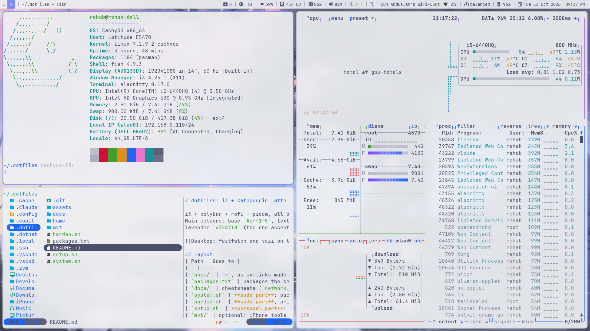

# dotfiles: i3 + Catppuccin Latte (CachyOS, Dell Latitude)

i3 + polybar + rofi + picom, all on Catppuccin Latte (light) with the lavender accent (the periwinkle of the grandfather-tree wallpaper).
Main colours: base `#eff1f5`, text `#4c4f69`, muted `#8c8fa1`, surface `#ccd0da`,
lavender `#7287fd` (the one accent: borders, current workspace, selections), red `#d20f39` (alerts).

## Layout
| Path | Goes to |
|---|---|
| `home/` | `~`, as symlinks made by GNU Stow (edit files here or via `~/.config/…`, same file) |
| `packages.txt` | packages the setup relies on |
| `docs/` | cheatsheets (`network.md`: speed, signal, device scans) |
| `system.sh` | **sudo part**: packages (pacman + AUR), GRUB, no splash, touchpad, locale, tty1 auto-login, SSH + firewall, background services, cache cleanup |
| `harden.sh` | **sudo part**, privacy + security (run by `system.sh`, or on its own): see below |
| `setup.sh` | **personal part**: stows `home/` into `~`, applies desktop settings |
| `mvt/` | optional: iPhone tools (libimobiledevice, idevicerestore) + MVT, `./mvt/install.sh` (see `mvt/README.md`) |

Fresh install: `./system.sh`, then `./setup.sh`, then reboot.

## Hardening (`harden.sh`)
- **DNS**: everything goes to AdGuard on `homelab` via Tailscale. No Google/Cloudflare fallback, no LLMNR/mDNS.
  `dns-failover.timer` turns Tailscale DNS off while AdGuard doesn't answer, so the Wi-Fi router's DNS takes over,
  and back on when it does (`journalctl -t dns-failover`). With Tailscale down, the router's DNS is used.
- **Network**: no NetworkManager connectivity check (`ping.archlinux.org`), random-but-stable MAC per network, hostname not sent over DHCP, IPv6 privacy addresses.
  Hotel/airport login page: open any `http://` site by hand.
- **Firewall**: incoming denied; SSH (keys only, no root) only over `tailscale0`.
- **OpenSnitch**: the daemon always enforces saved allow/deny rules. Prompts for new programs only while the UI is open (rofi: "OpenSnitch"; not started at login so it stays off polybar; quit it from its tray menu). Tray icons: Papirus-Light set in Latte colours (`assets/opensnitch`), re-applied by a pacman hook after updates. Pre-allowed: tailscaled, resolved, NetworkManager, timesyncd, pacman, localhost, tailnet.
- **Firefox** (`/etc/firefox/policies`): telemetry, studies, sponsored items, Firefox's own DoH off and locked. **VS Code**: telemetry and experiments off.
- **Kernel**: extra sysctls (`/etc/sysctl.d/90-hardening.conf`), no core dumps on disk.
- Not covered: the disk is not encrypted (needs a reinstall with LUKS).

## What's in it
- **i3**: `~/.config/i3/config` (sections: basics, apps, windows, workspaces, Fn keys, rules, startup), `xob.sh` (volume/brightness OSD), `dev.json` + `dev.sh` (Super+F2: dev layout on the current empty workspace, VS Code left, Firefox top right, Alacritty bottom right)
- **polybar**: config, `launch.sh` (single start at login, logs to `$XDG_RUNTIME_DIR/polybar-*.log`), `scripts/arch_updates.sh` (cached update count), `scripts/bluetooth.sh`, `scripts/power_profile.sh` (power profile next to the battery: left-click next, right-click previous)
- **rofi**: `latte.rasi` theme, `keyhelp.py` (Super+/ shortcut list built from the i3 config), `powermenu.sh` (Super+Esc / Super+Shift+E)
- **alacritty, dunst, btop, micro, VS Code**: official Catppuccin Latte colours; btop and micro have no background so the terminal's 90% opacity shows through
- **picom, xob, flameshot**: Latte colours, no animations
- **GTK 3/4, Kvantum, Papirus**: Catppuccin Latte (lavender), no animations. The GTK theme is the official release zip in `~/.local/share/themes` (setup.sh downloads it), not an AUR package
- **Login**: tty1 auto-login (getty override written by `system.sh`) → fish `conf.d/startx.fish` → `~/.xinitrc` (loads `~/.profile`) → i3. No display manager.
- **yazi**: hidden files shown, micro as editor
- **System** (`system.sh`): GRUB hidden menu with 0s timeout, no boot splash (Plymouth removed), touchpad natural scrolling (`/etc/X11/xorg.conf.d/30-touchpad.conf`), `LC_TIME=en_GB.UTF-8`, sshd + ufw (port 22), paccache.timer; cups only on demand (socket), avahi and NetworkManager-wait-online off

## Settings not stored in files (applied by setup.sh)
- gsettings: GTK theme, Papirus-Light icons, light colour scheme, animations off
- blueman: tray icon plugins off (`!StatusIcon`, `!ShowConnected`)
- `clipmenud` user service disabled at login (i3 starts it once X is up)

## Manual extras
- Fn lock: `Fn+Esc`
- Boot menu: hold Shift / tap Esc after the Dell logo
- Undo auto-login: delete the getty override and `sudo systemctl enable ly@tty2.service`

## Day to day
- Edit configs where they normally live; they are symlinks into this repo. Then `git -C ~/.dotfiles commit -am "…"`.
- New config file: move it into `home/` at the same path, then `stow -d ~/.dotfiles -t ~ --restow home`.
- If an app replaced a symlink with a real file (flameshot or Kvantum Manager saving settings can do this),
  copy it back into `home/` and `--restow`; `git status` shows the change.
- `sed -i` replaces a symlink with a plain file; use `sed -i --follow-symlinks`, or edit the copy in `home/`.
